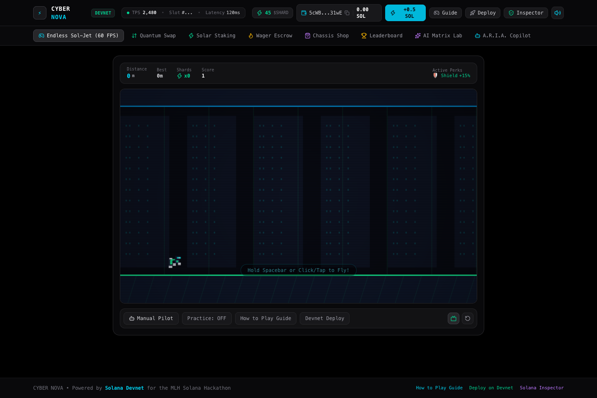

# ⚡ CYBER NOVA: Sol-Jet Velocity
> **An endless high-octane cyber-runner powered natively by Solana Devnet, autonomous AI agents, in-game DeFi yield reactors, and on-chain flight distance attestations.**  
> *Inspired by classic endless runner mechanics (hold to thrust, release to descend), built with 100% original sci-fi IP, characters, vehicles, and procedural physics for the MLH Solana Hackathon (November 2026).*

[](https://solarena-nine.vercel.app)
[](https://github.com/sharmao07/cyber-nova-solana)
[](https://explorer.solana.com/?cluster=devnet)
[](https://nextjs.org)
[](https://www.typescriptlang.org)
[](https://tailwindcss.com)

🔗 **Live Production Site:** [https://solarena-nine.vercel.app](https://solarena-nine.vercel.app)  
📦 **Source Code Repository:** [https://github.com/sharmao07/cyber-nova-solana](https://github.com/sharmao07/cyber-nova-solana)

---

## 🎮 Gameplay Preview



---

## 🌌 Original Lore & Endless Jetpack Universe

* **Protagonist:** **NOVA the Sol-Jet Runner** — Equipped with a twin-nozzle chrome photon jetpack, an aerodynamic neon visor, and a magnetic thruster harness. Holding thrust propels Nova vertically upward with intense exhaust particles scattering floor lab scientists; releasing cuts engine power to glide downwards through procedural hazard corridors.
* **Autonomous AI Copilot:** **A.R.I.A. (Autonomous Runner Intelligence Agent)** — An autonomous tactical copilot with its own ed25519 Solana Devnet keypair. A.R.I.A. scans upcoming 320px threat windows, detects zapper clearance gaps, computes missile evasion vectors, and autonomously signs flight distance records to the Solana blockchain.
* **Original Rideable Cyber Vehicles (with Eject-Armor Protection):**
  - **Gravity Drifter:** High-tech inverted hoverpod. Tapping space or clicking flips gravity polarity instantly between ceiling and floor!
  - **Mech Breaker:** Armored bipedal walker stomping across the lab floor. Tap to perform heavy hydraulic leaps!
  - **Warp Cycle:** Supersonic anti-grav speeder bike blazing across the facility at 1.4x standard cruise speed!
  - **Eject-Armor Mechanism:** When piloting any vehicle, taking a fatal hazard hit destroys the vehicle but safely ejects Nova back into flight with temporary invulnerability!
* **Hazards & Facility Obstacles:**
  - **Quantum Zappers:** Pulsating dual-emitter plasma barriers positioned horizontally, vertically, diagonally, and in spinning dual-rotor configurations.
  - **Homing Seeker Missiles `[ ! ]`:** Directional tracking beacons display an audio-visual warning tracking Nova's altitude before launching high-speed missiles across the screen.
  - **Laser Containment Gates:** High-voltage vertical containment beams sealing off corridors.
  - **Panicked Lab Scientists:** Procedural ground NPCs running frantically across the floor as Nova's thrusters burn overhead.
* **Collectibles & Upgrades:**
  - **Floating Solana Shards `($)`:** Spinning golden cryptographic tokens arranged in procedural sine waves, coins grids, and hazard bypass paths. Collect shards to spend in the AMM swap, Chassis Shop, or Staking Vault!

---

## 🏆 Hackathon Multi-Track Qualification Guide

Cyber Nova was architected from the ground up to **legitimately qualify for and excel across all five prize tracks**:

```
                      ┌──────────────────────────────────────────────┐
                      │              CYBER NOVA ECOSYSTEM            │
                      └──────────────────────┬───────────────────────┘
                                             │
      ┌──────────────────┬───────────────────┼───────────────────┬──────────────────┐
      ▼                  ▼                   ▼                   ▼                  ▼
┌───────────┐      ┌───────────┐       ┌───────────┐       ┌───────────┐      ┌───────────┐
│  GAMING   │      │    AI     │       │   DEFI    │       │ BEGINNER  │      │   TOP 3   │
│   TRACK   │      │   TRACK   │       │   TRACK   │       │   TRACK   │      │  OVERALL  │
├───────────┤      ├───────────┤       ├───────────┤       ├───────────┤      ├───────────┤
│• 60 FPS   │      │• Auto AI  │       │• In-Game  │       │• 1-Click  │      │• 400ms    │
│  Physics  │      │  Agent w/ │       │  DEX AMM  │       │  Burner   │      │  Sub-sec  │
│• Vehicles │      │  Wallet   │       │  (x*y=k)  │       │  Wallet   │      │  Speed    │
│• Zappers  │      │• Real-time│       │• Solar    │       │• Funded   │      │• Deep     │
│  & Missiles│     │  corridors│       │  Yield    │       │  Faucet   │      │  Solana   │
│• Attested │      │• Wave Gen │       │  Reactor  │       │• "ELI5    │      │  Native   │
│  Distance │      │• ARIA NLP │       │• Escrows  │       │  Mode"    │      │  Design   │
└───────────┘      └───────────┘       └───────────┘       └───────────┘      └───────────┘
```

### 1. Gaming Track ($100 Prize)
* **High-Precision 60 FPS Jetpack Physics:** Authentic thrust acceleration, gravity glide dynamics, ceiling/floor boundary collisions, procedural zapper generation, homing missile tracking, vehicle transformation mechanics, and shard magnetism.
* **Procedural Facility Generation:** Dynamic distance-scaling difficulty with rotating zapper clusters, high-speed missile waves, and vehicle token drops.
* **On-Chain Flight Distance Attestations:** When Nova crashes or reaches distance milestones, your total meters flown, shards collected, and run score are cryptographically signed on Solana Devnet via Memo Program instructions, producing an immutable Solscan proof badge.
* **Custom Flight Skins & Thrusters:** Upgrade to *Plasma Ember* (dual plasma trail), *24K Validator* (solar flare thruster), and *Shadow Matrix* (stealth ion exhaust).

### 2. AI Track ($100 Prize)
* **Autonomous AI Copilot ("A.R.I.A."):** Toggle the **"AI Copilot"** switch to watch an autonomous agent pilot Nova at 60 FPS. It evaluates a 320px threat corridor, calculates clearance altitudes, anticipates missile trajectories, and navigates rotating zappers.
* **Autonomous Agent with Dedicated Solana Wallet:** A.R.I.A. holds its own ed25519 Solana keypair. When it achieves distance records, it **autonomously signs an on-chain verification transaction** on Solana Devnet (`AI_AGENT_AUTONOMOUS_CLEAR`), paying its own gas fees!
* **AI Hazard & Flight Architect:** Synthesize custom procedural facility waves from natural language prompts (e.g., *"Dense rotating zappers, rapid-fire homing missiles, and lots of floating Solana Shards"*).
* **A.R.I.A. NLP Terminal:** Conversational AI copilot that executes on-chain operations from plain English (*"Airdrop me 0.5 SOL"*, *"Swap 50 shards for SOL"*, *"Explain quantum zapper clearance"*).

### 3. DeFi Track ($100 Prize)
* **Quantum Swap Constant Product AMM DEX ($x \cdot y = k$):** An in-game automated market maker pool between in-game earned `$SHARD` and real Devnet `$SOL`. Players who collect shards during flight can swap them directly for SOL with 0.3% LP fees.
* **Solar Staking Reactor (18.5% APY):** Stake SOL to earn streaming yield and unlock active flight perks:
  - *Bronze (≥0.05 SOL):* +15% Shard Multiplier
  - *Silver (≥0.10 SOL):* Kinetic Energy Shield (absorbs 1 fatal hit!)
  - *Gold (≥0.25 SOL):* Shard Magnetism (vacuums all shards within 180px!)
* **Distance Wager Escrow:** Wager 0.05, 0.1, or 0.25 SOL into a decentralized escrow contract. Reach your target flight distance (800m, 1,500m, or 2,500m) to win up to a 2.2x bounty payout!

### 4. Best Beginner Hack Track ($100 Prize)
* **Zero-Friction 1-Click Burner Wallet:** New players and hackathon judges don't need Phantom installed. A local ed25519 keypair is instantly generated client-side and saved in browser storage.
* **Funded Instant Devnet Faucet:** One click on "Airdrop +0.5 SOL" transfers real Devnet SOL straight to your wallet from our pre-funded 8.75 SOL treasury keypair (`AQhLYu2J81QJs1YaSAEkc9jpWk4Ez16f1svEcsvoox4P`).
* **Interactive "Solana Inspector" (ELI5 Mode):** Visual drawer breaking down transaction instructions, gas fees (~0.000005 SOL), 400ms confirmation latency, and plain-English concepts for beginner developers.

### 5. Top 3 Overall ($1,000 Microgrant)
* **Sub-Second Speed & Low Fees Doing Real Work:** Solana is not bolted onto an existing game; every shard swap, distance attestation, wager escrow, and autonomous AI transaction executes at 400ms block speeds with micro-gas fees that would be impossible on any other blockchain.
* **Zero External Dependencies / Pure Web Audio Synthesis:** 100% reliable procedural Web Audio synthesizer (thrust loops, zapper shocks, missile warning sirens, shard chimes, and crash sounds) that never 404s or suffers from CORS issues.
* **Production-Ready & Fully Tested:** Built with Next.js 16, TypeScript, Tailwind 4, `@solana/web3.js`, and tested with confirmed live Devnet transactions.

---

## 🕹️ Controls

| Action | Keyboard | Mouse / Touch Screen | In Gravity Drifter |
| :--- | :--- | :--- | :--- |
| **Fire Jetpack Thrusters** | `Space` / `W` / `↑` (Hold) | Left Click / Touch (Hold) | N/A |
| **Glide Down (Cut Engines)** | Release Key | Release Click / Touch | N/A |
| **Invert Gravity Polarity** | `Space` / `W` (Tap) | Click / Tap Screen | Flips ceiling ↔ floor |
| **Pause Simulation** | `P` / `Esc` | Click HUD Pause | Pause |
| **Toggle AI Copilot** | Click "AI Copilot" Toggle | Click "AI Copilot" Toggle | Autonomous Hands-Free |
| **Toggle Practice Mode** | Click "Practice Mode" | Click "Practice Mode" | Invincible Training |

---

## 📜 Verified Solana Devnet Transactions

All features interact with the live Solana Devnet cluster. Here are verified transaction proofs on Solscan:

| Type | Signature | Solscan Link |
| :--- | :--- | :--- |
| **Distance Run Attestation** | `mJzf3VR2...` | [View on Solscan](https://solscan.io/tx/mJzf3VR2cP1q3BKjcKDbohwDahBWsbT8EWJEVvz9DJxMDgUgve3yXDN2LWCWNQR9CbdViHCBSffE8KYBGaapLaT?cluster=devnet) |
| **A.R.I.A. Autonomous AI Attestation** | `UkcKEXc4...` | [View on Solscan](https://solscan.io/tx/UkcKEXc4jMsHB9t2q5YDfxy3xjy3jCKg5Qsd71ERjLucKcBqiAvdFa36ePAvS49bMpWWXdY51nxkZA942eYy3Yg?cluster=devnet) |
| **Faucet Devnet Distribution** | `2k8Mr8Wu...` | [View on Solscan](https://solscan.io/tx/2k8Mr8WuwdMmxYqcyC9d9jFPXxuFZ2Nux1NKWHYjwRLQffCxak9wppouoaRwmL8Gzwkcz14z76627WFGBsEtMsqp?cluster=devnet) |
| **Test Verification Attestation** | `5PJefb79...` | [View on Solscan](https://solscan.io/tx/5PJefb79g27tuFCrgWLmYsVWXmdPBxT8EL7yPrANrJ4FGatPyP2aJhbCGkJs5MCKdJrXpD4oFXCbA9ZUa4x5e4c7?cluster=devnet) |
| **Live Treasury Keypair** | `AQhLYu...ox4P` | [View on Solscan](https://solscan.io/account/AQhLYu2J81QJs1YaSAEkc9jpWk4Ez16f1svEcsvoox4P?cluster=devnet) |

---

## 🚀 Local Development & Quickstart

```bash
# Clone the repository
git clone https://github.com/sharmao07/cyber-nova-solana.git
cd cyber-nova-solana

# Install dependencies
pnpm install

# Run Solana Devnet integration test
pnpm run test:solana

# Start local development server
pnpm run dev
```

Open [http://localhost:3000](http://localhost:3000) in your browser.

---

## 📄 License

MIT License — Built with pride for the **MLH Solana Hackathon 2026**.
