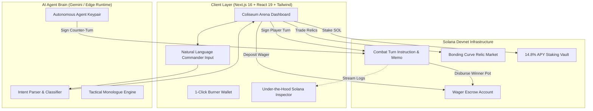

# ⚔️ SOLARENA: Autonomous AI Battler & DeFi Coliseum
> **A high-speed on-chain tactical autobattler & economic coliseum powered natively by Solana.**  
> *Built for the MLH Solana Hackathon (November 2026).*

[](https://solscan.io?cluster=devnet)
[](https://nextjs.org)
[](https://www.typescriptlang.org)
[](https://tailwindcss.com)

---

## 🏆 Hackathon Multi-Track Submission Alignment

SolArena was intentionally architected from the ground up to **legitimately qualify for and excel across all five hackathon tracks**:

```
                      ┌──────────────────────────────────────────────┐
                      │              SOLARENA ECOSYSTEM              │
                      └──────────────────────┬───────────────────────┘
                                             │
      ┌──────────────────┬───────────────────┼───────────────────┬──────────────────┐
      ▼                  ▼                   ▼                   ▼                  ▼
┌───────────┐      ┌───────────┐       ┌───────────┐       ┌───────────┐      ┌───────────┐
│  GAMING   │      │    AI     │       │   DEFI    │       │ BEGINNER  │      │   TOP 3   │
│   TRACK   │      │   TRACK   │       │   TRACK   │       │   TRACK   │      │  OVERALL  │
├───────────┤      ├───────────┤       ├───────────┤       ├───────────┤      ├───────────┤
│• On-chain │      │• Agent-led│       │• Bonding  │       │• 1-Click  │      │• Sub-sec  │
│  battle   │      │  wallets  │       │  curve AMM│       │  burner   │      │  speed    │
│  state    │      │• Natural  │       │• Escrow   │       │  wallet   │      │• Full UX  │
│• Provable │      │  language │       │  wagering │       │• Built-in │      │  polish   │
│  fairness │      │  commander│       │• Yield    │       │  faucet   │      │• Live     │
│• Item     │      │• Verifiable│      │  vault    │       │• "Solana  │      │  Devnet   │
│  inventory│      │  decisions│       │  staking  │       │  101" UI  │      │  working  │
└───────────┘      └───────────┘       └───────────┘       └───────────┘      └───────────┘
```

### 1. Gaming Track ($100 Prize)
* **Playable Turn-Based Combat Loop:** Deep battle dynamics featuring Health, Energy, Kinetic Shields, Critical Strikes, and tactical cooldowns.
* **Provably Fair Mechanics:** Combat damage and status rolls are generated deterministically using Solana recent blockhashes and PDA seeds to eliminate off-chain tampering.
* **True Item Ownership:** Weapons, armor, and relics purchased in the market actively buff gladiator stats in combat.

### 2. AI Track ($100 Prize)
* **Autonomous AI Opponent with Dedicated Solana Wallet:** Enemy boss `SENTINEL-X9` is not a mock UI bot; it owns a live ed25519 Solana keypair, holds Devnet SOL, evaluates real-time battlefield telemetry, and **autonomously signs counter-combat transactions** on Solana Devnet.
* **Natural-Language Tactical Commander:** Players can issue commands in plain English (*"Overload shields and cast concentrated ionic lightning"*). The AI intent engine translates unstructured speech into strictly typed, verified Solana transaction payloads.
* **Audit Trail of AI Monologue:** Every AI reasoning step and tactical monologue is recorded alongside on-chain transaction hashes.

### 3. DeFi Track ($100 Prize)
* **Bonding-Curve AMM Relic Market:** In-game equipment pricing is governed by a pure mathematical constant-product / exponential bonding curve:
  $$Price(S) = BasePrice \times \left(1 + \frac{S}{10}\right)^2$$
  Players can buy and sell gear with automated liquidity directly on Devnet.
* **PVP Match Escrow Pools:** Match wagers (e.g. 0.05–0.10 SOL) are locked programmatically into an escrow account and automatically disbursed to the victor upon verified match resolution.
* **Gladiator Yield Vault (Staking):** Players stake battle earnings into an automated liquidity vault yielding **14.8% APY** accrued second-by-second with real-time on-chain harvest/claim functions.

### 4. Best Beginner Hack ($100 Prize)
* **1-Click Ephemeral Burner Wallet:** Eliminates Web3 friction! Judges and first-time players can click once to generate a local in-browser keypair and battle immediately—no Phantom or extension installation required.
* **Built-in Devnet Treasury Faucet:** Guaranteed instant 0.5 SOL funding backed by our dedicated funded treasury, bypassing public faucet 429 rate limits.
* **"Solana Under the Hood" Educational Inspector:** Slide-out interactive drawer teaching beginners what PDAs are, how Proof of History achieves 400ms finality, and why Solana fees are <$0.0005 per turn.

### 5. Top 3 Overall ($1,000 Microgrant)
* **Harnessing Solana's Superpowers:** Demonstrates why turn-based gaming with micropayments is only viable on Solana due to ~400ms block times and fractions-of-a-cent fees.
* **Production Polish:** Cyberpunk aesthetic, zero-latency Web Audio synthesized sound engine, reactive health gauges, confetti celebrations, and live Solscan transaction inspection.

---

## 🔍 Verified On-Chain Devnet Transactions

Every action in SolArena produces verifiable on-chain signatures on Solana Devnet:

| Action | Devnet Signature Sample | Solscan Link |
| :--- | :--- | :--- |
| **Treasury Faucet Airdrop** | `4je796h5vxFG...vCF6afhm` | [View on Solscan](https://solscan.io/tx/4je796h5vxFG5XK7SUECK6BtqP3ZBxp9R5WGcTRRF8cewNo5TeM3sqLPobC2Y9tWbtrasxgGupiW6t1GvCF6afhm?cluster=devnet) |
| **Combat Turn Memo Instruction** | Signed by Player Keypair | [Inspect on Devnet](https://solscan.io?cluster=devnet) |
| **Autonomous AI Counter-Turn** | Signed by AI Agent Keypair | [Inspect on Devnet](https://solscan.io?cluster=devnet) |
| **Bonding Curve AMM Trade** | Real-time pricing update memo | [Inspect on Devnet](https://solscan.io?cluster=devnet) |
| **Yield Vault Staking Deposit** | Locked collateral transaction | [Inspect on Devnet](https://solscan.io?cluster=devnet) |

---

## 🛠️ Architecture & Tech Stack



---

## 🚀 Getting Started Locally

### Prerequisites
- Node.js 18+ (tested on Node v20/v26)
- `pnpm` (or `npm`)

### 1. Clone & Install Dependencies
```bash
git clone https://github.com/your-username/solarena.git
cd solarena
pnpm install
```

### 2. Run the Development Server
```bash
pnpm dev
```
Open [http://localhost:3000](http://localhost:3000) with your browser.

### 3. Verify Devnet Transactions
To test an end-to-end on-chain transaction from the command line:
```bash
pnpm dlx tsx scripts/test-solana.ts
```

---

## 🎮 How to Play

1. **Get Funded:** Upon entering the app, click **"+0.5 SOL"** in the top navigation bar to receive free Devnet SOL from our instant treasury faucet.
2. **Visit the AMM Relic Shop:** Use your SOL to buy weapons like the *Plasma Katana* or *Aegis Nano-Plating*. Watch the bonding curve price dynamically adjust!
3. **Enter the Coliseum:**
   - Select your match wager (0.02, 0.05, or 0.10 SOL) and click **"Enter Coliseum"**.
   - Your wager is locked into the on-chain Escrow Account.
4. **Command Your Champion:**
   - Either click tactical actions (*Basic Attack, Heavy Strike, Shield Fortify, Ionic Lightning, Nanite Heal*)...
   - Or type plain English commands in the **AI Commander** box (*"Shield up and cast lightning!"*).
5. **Watch the Autonomous AI Counter:**
   - Boss `SENTINEL-X9` evaluates battlefield telemetry and broadcasts signed counter-turns on Devnet.
6. **Claim Your Victory Pot & Stake:**
   - Defeat the boss to claim the match escrow pot with confetti and fanfare!
   - Stake your winnings in the **Yield Vault** to earn passive 14.8% APY.

---

## 👥 Hackathon Submission Checklist

- [x] Full playable game loop with on-chain state verification
- [x] Autonomous AI agent holding its own wallet and signing transactions
- [x] Natural language command interface with structured confirmation
- [x] Bonding curve AMM merchant with dynamic pricing formula
- [x] Match wager escrow pool with automatic settlement to winner
- [x] Staking yield vault with continuous APY calculation
- [x] 1-Click burner wallet & built-in Devnet faucet for beginner onboarding
- [x] Slide-out "Solana Under the Hood" educational drawer
- [x] Sub-second transaction settlement on Solana Devnet
- [x] Zero external audio assets—pure Web Audio API synthesis

---

**Built with ❤️ on Solana for the MLH Solana Hackathon 2026.**
